# Retail Lakehouse on Databricks

This project shows an end-to-end Data Engineering portfolio built with **Databricks, Apache Spark, Spark SQL, Python, and Delta Lake**.

The project demonstrates how to ingest data from a REST API, preserve raw snapshots, generate synthetic retail transactions, transform semi-structured data into structured datasets, and build analytical tables using a Medallion Architecture. It also includes workflow orchestration through Databricks Jobs, pipeline design and schedule setting.

> **Data disclaimer:** 

This project combines product and cart data from the DummyJSON public API with simulated product variations and synthetic sales transactions. Synthetic transactions are generated for engineering and analytical demonstration purposes.
---

## Project Overview

The goal of this project is to build a small but complete Lakehouse pipeline that demonstrates practical Data Engineering concepts:

- REST API ingestion using Python.
- Raw data preservation using an append-only Bronze layer (Idempotency).
- Synthetic data generation.
- Data transformation using Apache Spark and Spark SQL.
- Delta Lake tables and `MERGE INTO` operations.
- Analytical fact table creation.
- Medallion Architecture implementation.
- Workflow orchestration and scheduling with Databricks Jobs.

The project uses a public API as its external data source and generates synthetic transactions to provide a richer dataset for analytical modeling.

## Architecture

The pipeline follows the Standard Medallion Architecture:

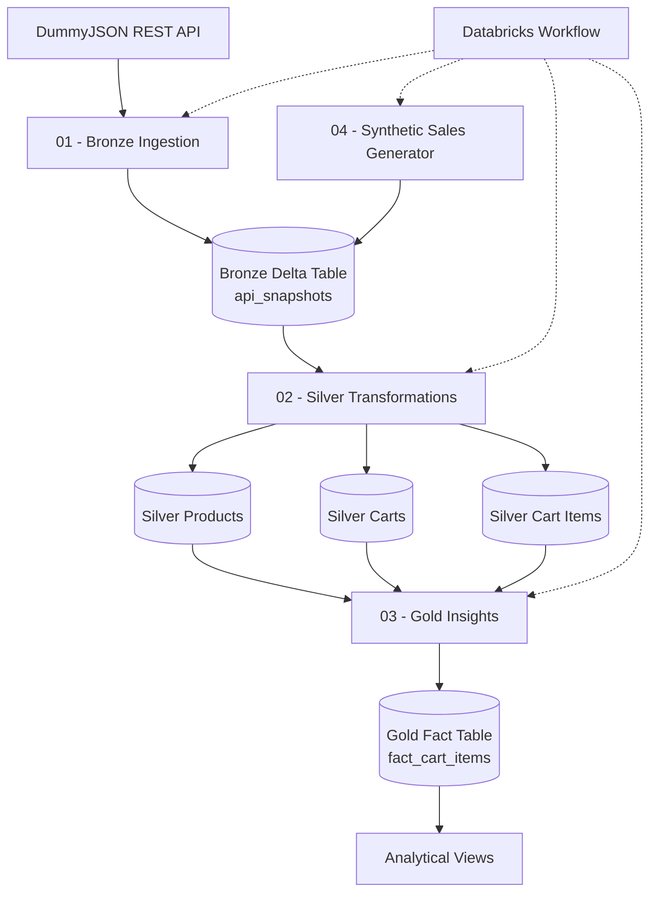

### Medallion Layers

| Layer | Purpose | Main object |
|---|---|---|
| Bronze | Preserve raw API and generated data snapshots | `bronze.api_snapshots` |
| Silver | Parse, clean, standardize, and normalize data | `silver.products`, `silver.carts`, `silver.cart_items` |
| Gold | Provide an analytical fact table and reporting structures | `gold.fact_cart_items` |

---

## Technology Stack

| Technology | Usage |
|---|---|
| Databricks Free Edition | Lakehouse development and workflow orchestration |
| Apache Spark | Distributed data processing engine |
| Spark SQL | Data transformations and analytical modeling |
| Python | REST API extraction and synthetic data generation |
| Delta Lake | Storage format for Bronze, Silver, and Gold tables |
| DummyJSON API | External source for product and cart data |
| Databricks Jobs | Pipeline task orchestration and scheduling |

---

## Data Sources

The project uses two types of data.

### 1. DummyJSON REST API

Source: https://dummyjson.com

The ingestion notebook retrieves:

- Products
- Carts

The API extraction uses pagination (`limit` and `skip`) to retrieve the available records. Each extraction stores the original payload as JSON in the Bronze layer.

### 2. Synthetic Data

Two types of simulated data are generated:

**Simulated products**

Product price and stock values are adjusted between ingestion runs using the API values and previously simulated state. The original API payload remains unchanged. Simulated records include metadata describing the origin and the generated changes.

**Synthetic carts**

A separate notebook generates between 200 and 400 synthetic carts per execution.

Each cart contains:

- A randomly selected set of products.
- Random quantities.
- Gross and discounted line amounts.
- Cart totals.
- A synthetic cart identifier.
- Simulation metadata.

Synthetic carts are stored and managed separately from API carts through the `source` column, making the distinction between them.

---

## Pipeline Execution

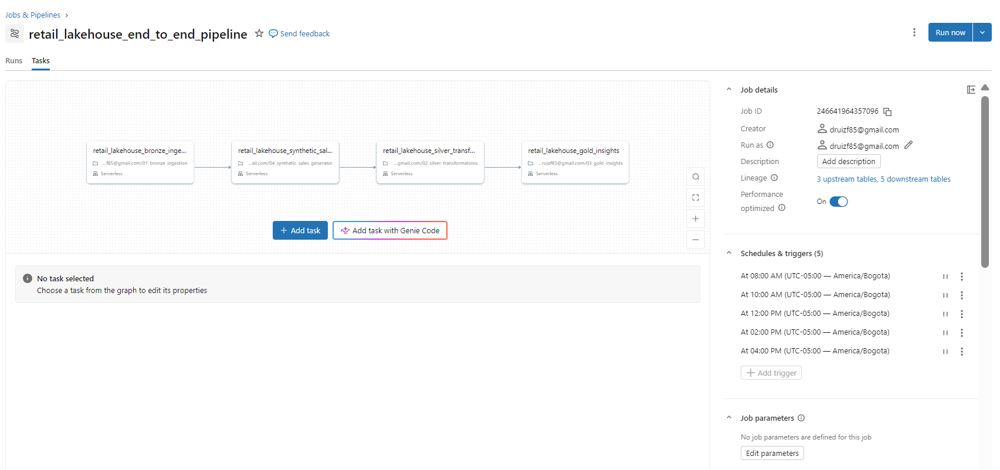

The project is organized into four notebooks.

| Notebook | Responsibility |
|---|---|
| `01_bronze_ingestion` | Extract API data, generate simulated product snapshots, and append records to Bronze |
| `04_synthetic_sales_generator` | Generate synthetic carts and append them to Bronze |
| `02_silver_transformations` | Transform Bronze records into structured Silver tables |
| `03_gold_insights` | Build the analytical Gold fact table |

The Databricks Job shown in the project evidence orchestrates the notebooks in the following order:

1. Bronze ingestion
2. Synthetic sales generation
3. Silver transformations
4. Gold insights

The workflow is configured with scheduled executions in the `America/Bogota` timezone.

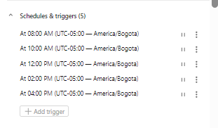

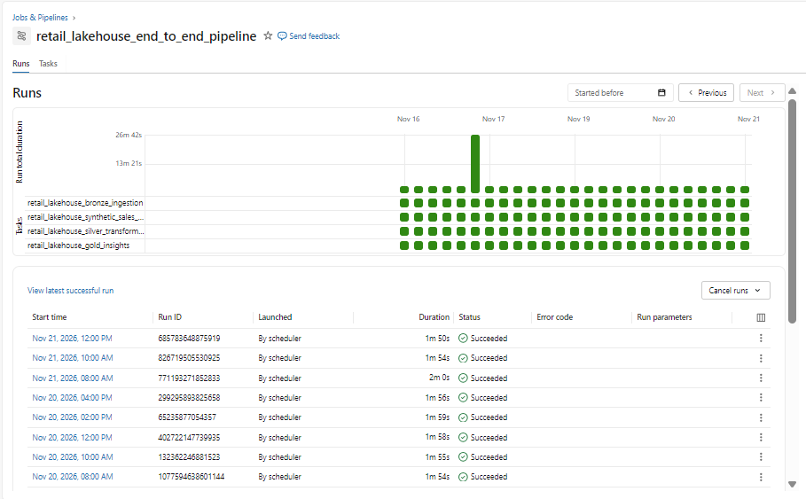

---

## Data Model

The main datasets are:

### Bronze

`retail_lakehouse_dr.bronze.api_snapshots`

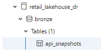

An append-only Delta table that stores raw JSON payloads and ingestion metadata.

### Silver

- `retail_lakehouse_dr.silver.products`
- `retail_lakehouse_dr.silver.carts`
- `retail_lakehouse_dr.silver.cart_items`

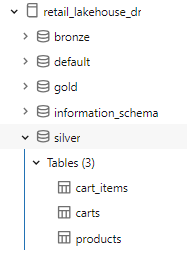

The Silver layer parses JSON attributes into typed columns and preserves source-level lineage.

Cart products are expanded into individual item records, with `item_index` preserving their position within each cart snapshot.

### Gold

`retail_lakehouse_dr.gold.fact_cart_items`

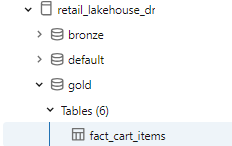

An analytical fact table at cart-item grain, combining the selected cart snapshot with its corresponding item records.

The project also includes five analytical view definitions:

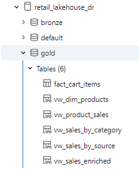

- `vw_product_sales`

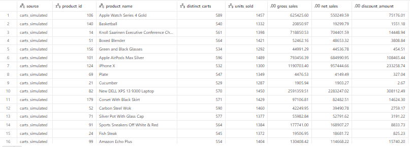

- `vw_sales_by_source`

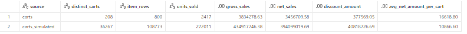

- `vw_dim_products`

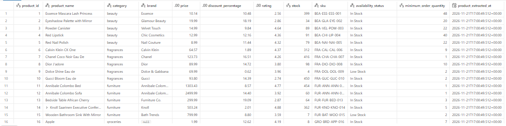

- `vw_sales_enriched`

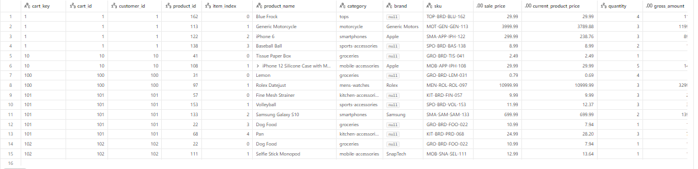

- `vw_sales_by_category`

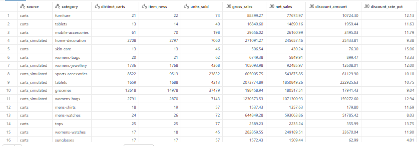

---

## Key Engineering Concepts

### Raw Data Preservation

The Bronze layer stores the original API payloads as JSON instead of immediately transforming them. By doing this, we preserve the original source representation and we allow downstream transformations to be revised without repeating the API extraction.

### Source Provenance

The `source` column distinguishes API records from simulated records.

Examples:

- `products`
- `carts`
- `products_simulated`
- `carts_simulated`

This distinction is used throughout the Silver and Gold layers.

### Delta Lake MERGE Operations

Silver transformations use `MERGE INTO` to insert new records and update matching records when relevant values change. The merge keys include source identity and execution metadata, allowing the historical snapshots of the same source entity to be retained.

### Semi-Structured Data Normalization

Inside the silver transformation process, we use `FROM_JSON` and `POSEXPLODE` to convert arrays into individual cart-item records.

---

## Setup and Execution

### Requirements

- Access to a Databricks workspace.
- Databricks Free Edition or an environment with compatible Spark and Delta Lake capabilities.
- Access to the public DummyJSON API.
- Permissions to create and modify the required catalog, schemas, tables, and jobs.

### Catalog

The notebooks reference the following catalog:

```sql
retail_lakehouse_dr
```

The expected schemas are:

```text
bronze
silver
gold
```

### Execution Order

Run the notebooks in the following order:

1. `01_bronze_ingestion`
2. `04_synthetic_sales_generator`
3. `02_silver_transformations`
4. `03_gold_insights`

The synthetic sales generator depends on simulated products being available in Bronze.

The Silver notebooks use existing target tables. Their table initialization statements are currently commented out in the supplied notebook, so the required Silver tables must exist before running the transformations.

The Gold notebook creates or replaces `fact_cart_items`.

The analytical view definitions are included as commented SQL in the Gold notebook and may need to be enabled and validated separately.